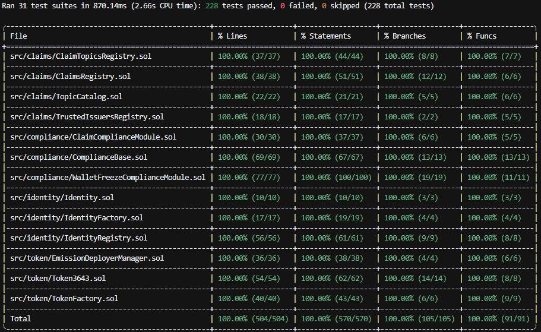

# ERC-3643 Token Protocol

A permissioned tokenization system inspired by the ERC-3643 and T-REX
model. It combines token issuance with on-chain identities, trusted issuers,
claims and modular transfer compliance.

The protocol is designed to support the issuance and transfer of tokenized
assets where participants must satisfy predefined eligibility requirements.

## Origin and License

This repository is a cleaned-up and rebranded copy of a permissioned
tokenization protocol I designed and implemented end to end as the sole
author of the contracts.

The original contracts were deployed and verified on Arbitrum One and
Arbitrum Sepolia under a different name. Every Solidity file carries an MIT
`SPDX-License-Identifier` and is republished under those terms. See
[LICENSE](LICENSE) for the copyright notice.

Selected addresses from the original Arbitrum One deployment are listed in
the [Deployments](#-deployments) section for reference. Broadcast artifacts,
execution traces, coverage reports and internal tooling have been removed
from this repository.

The repository contains the contract source, test suite, deployment and
operations scripts and exported ABIs. Addresses in `.env.example` and the
example recipient files are placeholders and must be populated before
running scripts that depend on them.

## ⚙️ How It Works

1. **Create an emission:** A token emission is deployed through the
   `TokenFactory`, together with the contracts required to manage its
   identities and compliance rules.

2. **Define eligibility requirements:** Required claim topics are configured
   for the emission. These can represent attributes such as KYC status,
   investor accreditation or jurisdiction.

3. **Register identities:** Wallets are linked to on-chain identities through
   the `IdentityRegistry`.

4. **Issue claims:** Trusted issuers write claims for identities in the
   `ClaimsRegistry`.

5. **Check transfers:** The compliance contracts evaluate the configured
   requirements before a token transfer can proceed.

6. **Manage exceptions:** Authorized roles can perform administrative
   actions such as freezing wallets or identities, pausing compliance
   operations and executing forced transfers.

## 🏗️ Architecture

The system is built around a token factory, identity and claim registries
and a modular compliance layer.

| Component | Responsibility |
| --- | --- |
| **TokenFactory** | Deploys and connects the contracts required for a token emission. |
| **Token3643** | Non-upgradeable permissioned token used for an emission. |
| **IdentityRegistry** | Links wallets to on-chain identities. |
| **IdentityFactory** | Creates `Identity` contracts for users. |
| **ClaimTopicsRegistry** | Defines the claim topics required for an emission. |
| **TrustedIssuersRegistry** | Manages trusted claim issuers. |
| **ClaimsRegistry** | Stores claims associated with identities and topics. |
| **ComplianceBase** | Coordinates compliance modules and enforces pause and token-caller checks. |
| **ClaimComplianceModule** | Checks whether the required claims are present for transfers. |
| **WalletFreezeComplianceModule** | Enforces wallet and identity freeze restrictions. |
| **TopicCatalog** | Shared catalog of claim topics across emissions. |

`IdentityRegistry`, `ComplianceBase`, `IdentityFactory`,
`ClaimTopicsRegistry`, `TrustedIssuersRegistry`, `ClaimsRegistry` and
`TopicCatalog` use UUPS proxies. `TopicCatalog` is shared globally across
emissions, while the emission-specific components are deployed through the
factory.

### Transfer Compliance Flow

1. `ClaimTopicsRegistry` defines the required claim topics for an emission.
2. Wallets are linked to identities in `IdentityRegistry`.
3. Trusted issuers write claims in `ClaimsRegistry`.
4. `ClaimComplianceModule` checks required topics during transfers.
5. `WalletFreezeComplianceModule` checks wallet and identity freeze status.
6. `ComplianceBase` coordinates the modules and enforces pause and
   token-caller checks.

### Claims and Compliance Modules

The system supports two ways of expressing transfer requirements:

- **Topics and claims:** Used for identity attributes attested in
  `ClaimsRegistry`, such as KYC status, investor accreditation or
  jurisdiction. Topics are registered in `TopicCatalog` and required per
  emission in `ClaimTopicsRegistry`. Adding a topic is a configuration
  change and does not require deploying a new compliance module.

- **Compliance modules:** Used for rules that depend on transfer context or
  contract-managed state. `WalletFreezeComplianceModule` is an example.
  Additional rules can be implemented as `IComplianceModule` contracts and
  connected to `ComplianceBase` without changing the token contract.

## 🚀 Features

### Tokenization

- Deploy permissioned tokens through a factory.
- Create the contract stack required for individual token emissions.
- Configure identity and transfer requirements for each emission.

### Identity and Claims

- Link wallets to on-chain identities.
- Define required claim topics.
- Manage trusted claim issuers.
- Record and verify claims associated with identities.

### Compliance and Administration

- Enforce transfer requirements through modular compliance contracts.
- Freeze wallets or identities when required.
- Support forced transfers through authorized roles.
- Pause and unpause compliance operations.
- Upgrade supported contracts through the UUPS proxy pattern.
- Manage permissions through role-based access control.

## 🌐 Deployments

The following addresses are selected contracts from the original deployment
on **Arbitrum One**.

The original protocol was deployed under a different name. This repository
is a cleaned-up and rebranded reference copy; its contents should not be
assumed to match the current deployed implementations exactly.

| Contract | Address | Deployment Type |
| --- | --- | --- |
| TopicCatalog | [0xAC20...0e04](https://arbiscan.io/address/0xAC20b602bE9C9e15b883976e7CC930031CC10e04#code) | UUPS proxy |
| TrustedIssuersRegistry | [0xD323...D42e](https://arbiscan.io/address/0xD32317c50f1df2C3605E049379EEf8B4068cD42e#code) | UUPS proxy |
| IdentityFactory | [0xB1a0...b5e](https://arbiscan.io/address/0xB1a0D495192c4641f69C35De13eAEd412Eeb3b5e#code) | UUPS proxy |
| ClaimsRegistry | [0x6ADe...B047](https://arbiscan.io/address/0x6ADe4AfF0391F27B73A67b1883Cd31397E55B047#code) | UUPS proxy |
| EmissionDeployerManager | [0x6680...d7A3](https://arbiscan.io/address/0x66803E307627f12E74FD207112B30751D5b4d7A3#code) | Contract |
| TokenFactory | [0x1245...6C95](https://arbiscan.io/address/0x1245A83626A270EcB224eD173fe2206Ff3046C95#code) | UUPS proxy |

## 🛠️ Tech Stack

- **Smart contracts:** Solidity.
- **Development and testing:** Foundry.
- **Tokenization model:** ERC-3643 / T-REX-inspired architecture.
- **Upgradeability:** UUPS proxies for supported contracts.
- **Supporting tooling:** Node.js and npm.

## 🔐 Roles and Permissions

The protocol uses role-based access control for administrative and
operational functions:

| Role | Responsibility |
| --- | --- |
| `UPGRADER_ROLE` | Upgrades UUPS contracts. |
| `ADMIN_ROLE` | Performs administrative operations on individual contracts. |
| `PAUSER_ROLE` | Pauses and unpauses `ComplianceBase`. |
| `COMPLIANCE_ADMIN_ROLE` | Manages identity binding in `IdentityRegistry`. |
| `AGENT_ROLE` | Performs forced transfers in `Token3643`. |

`DEFAULT_ADMIN_ROLE` is used for role administration and is not used
directly as a guard for business functions.

## 🧪 Testing

The project uses Foundry for its smart contract test suite. Tests are grouped
by domain, covering the token, identity, claims and compliance components.

### Run All Tests

```bash
forge test
```

### Generate a Coverage Report

```bash
npm run coverage
```

### Coverage Results

The coverage report shown below includes **228 passing tests** and **100%
coverage** across lines, statements, branches and functions for the measured
contracts in `src/`.



## 🔧 Getting Started

### Prerequisites

- [Foundry](https://book.getfoundry.sh/getting-started/installation)
- Git
- Node.js and npm

### Install Dependencies

```bash
git submodule update --init
npm install
```

### Build the Contracts

```bash
forge build
```

### Run the Tests

```bash
forge test
```

## 📦 Deployment and Operations

The project includes scripts for deployment, upgrades, compliance and
identity management.

### Deploy an Emission

The deployment flow described in the original repository is:

1. Deploy the `TokenFactory` proxy.
2. Call `TokenFactory.createEmission(...)` to deploy and connect the
   emission's contracts.

### Configure the Environment

Copy `.env.example` to `.env` and populate the values required by the
scripts you intend to run, including RPC URLs, the deployer key and relevant
contract addresses.

The repository's example addresses are placeholders.

### Operations Menu

The script `script/scriptMaster.sh` provides an interactive menu for
deployment, upgrades, compliance and identity operations.

See [`script/README.md`](script/README.md) for the environment variables
and instructions required by each script.

### Export Deployment Addresses

Off-chain consumers can read deployment addresses from
`deployments/addresses/<network>.json`.

That directory is empty in this public copy. The deployment files can be
generated from Foundry broadcast output using:

```bash
node script/tools/export-deployments.js
```

## 📁 Repository Structure

```text
erc3643-token-protocol/
├── src/
│   ├── token/              # Token and factory contracts
│   ├── identity/           # Identity, factory and registry contracts
│   ├── claims/             # Claim-related registries
│   ├── compliance/         # Compliance coordinator and modules
│   └── interfaces/         # Interfaces and shared errors/events
├── test/                   # Test suites grouped by domain
├── script/                 # Deployment, upgrade and operations scripts
├── deployments/
│   └── abis/               # Exported ABIs for off-chain consumers
├── docs/
│   └── images/
│       └── coverage.png    # Coverage report screenshot
├── .env.example            # Example environment configuration
├── LICENSE
└── README.md
```

## 🔒 Security

The architecture includes role-based permissions, transfer checks,
wallet and identity freezing, pausable compliance operations and
upgradeability controls.

The original contracts were reviewed internally before their deployment
under a different name. This repository is published as a reference and
portfolio project; it is not presented as deployment-ready software.

Any new deployment should be independently reviewed, tested and audited.

## 📚 Resources

- [ERC-3643 Specification](https://eips.ethereum.org/EIPS/eip-3643)
- [Foundry Book](https://book.getfoundry.sh/)
- [Solidity Documentation](https://docs.soliditylang.org/)

## ⚠️ Disclaimer

Permissioned token systems involve smart contract, operational and regulatory
risks. The compliance mechanisms in this repository are technical controls
and do not constitute legal or regulatory advice.

This repository is provided for reference and portfolio purposes. Any new
deployment should be assessed against its specific technical and legal
requirements.